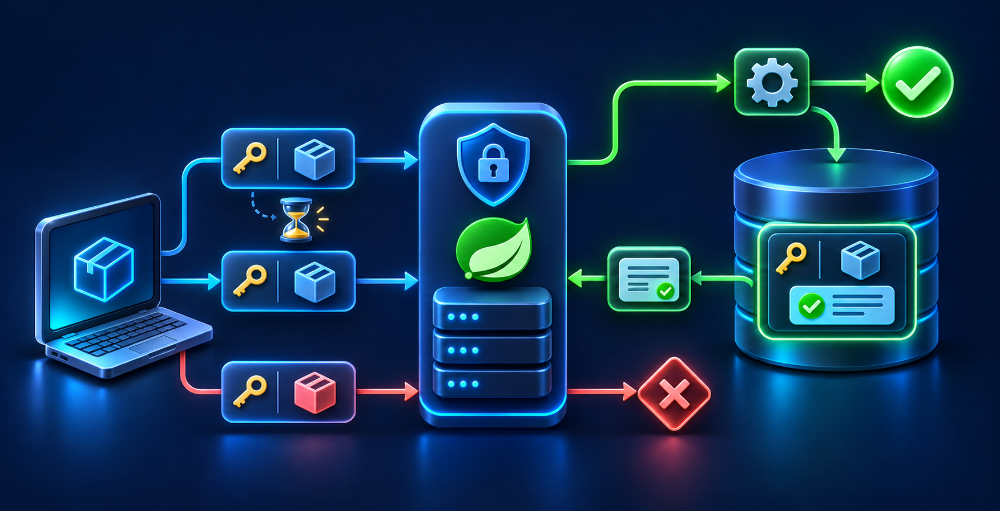

# Spring Boot Integration Lab

Proyecto breve para demostrar criterio de ingeniería al migrar integraciones legacy hacia una API Spring Boot.



## Qué evidencia

- API REST con validación de entrada y respuesta HTTP explícita.
- Idempotencia HTTP real: `Idempotency-Key` persiste la primera respuesta. Un reintento con la misma clave y el mismo payload responde sin ejecutar otra vez la regla de negocio.
- Seguridad activada para endpoints de negocio; la autenticación básica es deliberadamente simple en este laboratorio y debe sustituirse por JWT/OAuth2 en un entorno real.
- Idempotencia persistida con Spring Data JPA; H2 local y PostgreSQL mediante Docker Compose.
- Tests unitarios y MVC, más CI en GitHub Actions.

## Ejecutar

```bash
mvn spring-boot:run
```

Para ejecutar con PostgreSQL:

```bash
docker compose up -d
SPRING_PROFILES_ACTIVE=postgres mvn spring-boot:run
```

La API queda disponible en `http://localhost:8080`.

```bash
curl -u demo:demo -X POST http://localhost:8080/api/migrations \
  -H 'Content-Type: application/json' \
  -H 'Idempotency-Key: migration-legacy-42-v1' \
  -d '{"legacyReference":"LEGACY-42","targetSystem":"billing-v2","retry":false}'
```

Repetir exactamente la misma petición devuelve `202 Accepted`, el mismo resultado y el header `Idempotent-Replay: true`. Reutilizar la clave con otro payload devuelve `409 Conflict`; utilizar otra clave para una migración ya iniciada también se rechaza, salvo que exista un reintento explícito y auditado.

## Qué protege la idempotencia

1. El cliente puede reintentar por timeout sin crear dos migraciones.
2. La misma clave no puede ocultar un payload distinto: se compara una huella del request.
3. El resultado aceptado queda persistido con JPA, incluso si el proceso se reinicia.
4. La clave de idempotencia no reemplaza las reglas del dominio: una nueva clave no habilita duplicar una migración.

## Decisiones que importan en producción

- La clave se debe limitar a una operación y a un actor: no debe ser una clave global reutilizable.
- La huella debe incluir el payload canónico; si el mismo key llega con datos distintos, la API debe responder `409 Conflict`.
- La reserva de la clave debe ser atómica para que dos solicitudes concurrentes no ejecuten el efecto de negocio dos veces.
- Conviene definir una retención/TTL para limpiar claves antiguas sin perder la ventana de reintento esperada.
- Para efectos secundarios (eventos, correos, pagos), la idempotencia HTTP se complementa con outbox y consumidores idempotentes.

> Para producción, reemplazar Basic Auth por JWT/OAuth2, poner un límite de retención para las claves, garantizar reserva atómica ante concurrencia y publicar eventos con un patrón outbox. El objetivo de este repo es hacer visibles esas decisiones y sus pruebas.

## Pruebas

```bash
mvn verify
```
